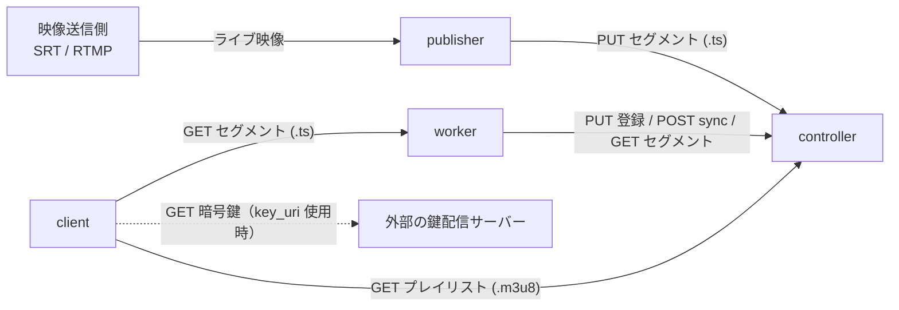

# Edamame

Edamame は、ライブ HLS 配信用のインメモリ配信サーバである。
プレイリストの生成とセグメントファイルの配信を別々のプロセスに分けることで、配信帯域の負荷を複数のサーバへ分散する。

一般的な HLS 配信では、エンコーダが `.m3u8`（プレイリスト）と `.ts`（セグメントファイル）の両方をオリジンサーバに書き出す。
これに対し、Edamame では次の 4 つの役割に分けて配信を行う。

- **publisher** は、映像を MPEG-TS（`.ts`）のセグメントファイルに分割して `controller` へ `PUT` する送信側プログラムである。プレイリストは作成も送信もしない。付属の `edamame-publisher` や `scripts/loop-publisher.py` のほか、HTTP API に従う任意のプログラムを使える。
- **controller** は、`publisher` から受け取ったセグメントファイルに `0` 始まりの連番（`sequence`）を割り当て、原本としてメモリ上に保管する。また、稼働中の `worker` が途切れずにキャッシュしているセグメントの範囲を基に、リクエストのたびにプレイリスト（`.m3u8`）を生成して `client` に返す。
- **worker** は、一定間隔で `controller` と同期（`sync`）し、不足しているセグメントファイルを取得してメモリ上にキャッシュする。`client` が再生する `.ts` ファイルの配信を担当し、複数台並べることで配信帯域の負荷を分散する。
- **client** は、視聴者が使う HLS プレイヤーである。`controller` からプレイリスト（`.m3u8`）を取得し、その中に書かれた `worker` の URL からセグメントファイル（`.ts`）を取得して再生する。



各コンポーネントの設定と動作、HTTP API、運用の詳細は [ドキュメント案内](./docs/README.md) から辿れる。

## 必要な環境

- Rust 1.99.1（edition 2024）でビルドを確認済み。`tomyou` は Rust 1.93 以降を要求する
- ネットワークの接続条件：
  - `publisher` と `worker` から、`controller` の HTTP または HTTPS アドレスへ接続できること
  - `client` から、`controller` のアドレス（プレイリスト取得用）へ接続できること
  - `client` から、`worker` の公開 URL（`--public-url`、セグメント取得用）へ接続できること
- `edamame-publisher` を動かす場合は、SRT と RTMP に対応した `ffmpeg` と `ffprobe`、およびエンコーダに応じた GPU 環境：
  - NVEnc（`h264_nvenc`）を使う場合：NVIDIA の GPU とドライバ
  - QSV（`h264_qsv`）を使う場合：Intel の GPU、VA-API ドライバ、oneVPL の GPU ランタイム
  - ソフトウェアエンコード（`libx264`）や映像コピー（`copy`）だけで動かす場合は GPU 不要

## 最短での起動手順

リポジトリのルートで `compose.yaml` を使い、`controller` と `worker` を起動する。
ホスト上の `client` から再生する前提で、公開 URL には `127.0.0.1` を使い、ポートもホストの `127.0.0.1` にだけ公開する。

```bash
docker compose up -d
docker compose ps
```

起動を確認する。

```bash
curl --fail --show-error http://127.0.0.1:9000/health
curl --fail --show-error http://127.0.0.1:9001/health
```

停止する場合は `docker compose down` を使う。
別ホストの `client` から再生する場合は、`worker` の `EDAMAME_PUBLIC_URL` を `client` から到達できるホスト名または IP アドレスに変更し、`ports` の `127.0.0.1` を外す。
`controller` を複数台で動かす場合は、各 controller の `EDAMAME_PUBLIC_URL` を peer、worker、client のすべてから到達できる名前にする（[controller の冗長化](./docs/cluster.md#起動と-dns-の設定)）。

ソースから直接起動する場合は [controller](./docs/controller.md#最小起動) と [worker](./docs/worker.md#最小の起動) の手順を使う。

### 必須条件と任意条件

各オプションの必須、任意、既定値、制約は、コンポーネントごとの文書にまとめている。

- controller：[設定](./docs/controller.md#設定)
- worker：[CLI と環境変数](./docs/worker.md#cli-と環境変数)
- publisher：[設定リファレンス](./docs/publisher.md#設定リファレンス)

各オプションは環境変数でも指定できる。
環境変数の名前は、オプション名の `-` を `_` に変えて先頭に `EDAMAME_` を付けたものにする（例：`--bind` は `EDAMAME_BIND`）。
コマンドライン引数と環境変数の両方を指定した場合は、コマンドライン引数を優先する。

`controller` の `--auth-token` は必須であり、`worker` と `publisher` にも同じ token を設定する。
`--public-url` には、peer、worker、client のすべてから到達できる機体固有の URL を指定する。
cluster の処理は常に有効であり、seed を省略した場合は自分 1 台で始まる。

複数台に増やすときは、参加する機体の `--seed` に起動済みの controller の URL を指定する。
leader の優先度を変える場合は `--metric` を指定する。
DNS の共有名から各機へ到達させる起動例は [controller の冗長化](./docs/cluster.md#起動と-dns-の設定)、交代による状態消失と通信分断時の制約は [controller の冗長化](./docs/cluster.md) を参照する。

## publisher

`crates/edamame-publisher` は、SRT または RTMP で受け取ったライブ映像を処理するプロセスである。
`ffmpeg` で複数画質（`quality`）の MPEG-TS セグメントに変換し、AES-128-CBC で暗号化して `controller` へ `PUT` し続ける。
GPU と `ffmpeg` を使うため、通常は `controller` や `worker` とは別のホストで動かす。
GPU と入力の設定が必要なため、既定の `compose.yaml` には含めていない。

```bash
cargo run --release -p edamame-publisher -- \
  --config crates/edamame-publisher/publisher.example.toml \
  --controller-url http://127.0.0.1:9000 \
  --auth-token example-token
```

設定ファイルの書き方、暗号化と鍵登録の仕組み、失敗時の扱いは [publisher](./docs/publisher.md) で説明する。
ローカルの MP4 ファイルを無限ループさせてテスト配信を行うスクリプトは [scripts/README.md](./scripts/README.md) で説明する。

## tomyou

`crates/tomyou` は、拠点の OBS から Edamame と ImageFlux へ同時に映像を送る GUI アプリである。
OBS の配信先をローカルの RTMP サーバへ変更し、Edamame 向けの RTMP と ImageFlux 向けの WHIP を別プロセスで送る。

```bash
cargo run --release -p tomyou
cargo run --release -p tomyou -- --config /path/to/config.toml
```

設定、OBS の条件、入力チェック、GStreamer の必要機能、ImageFlux の扱い、fallback 登録、障害時の動作は [tomyou](./docs/tomyou.md) で説明する。
`tomyou-v*` タグを push すると GitHub Actions が Windows / macOS / Linux のバイナリをビルドし、GitHub Release に添付する。
ImageFlux のプレイリストと鍵は、live2025-server へ fallback として登録する。
fallback 登録を使う場合は、`[stream_credentials]` に live2025-server のベース URL と `STREAM_INGEST_TOKEN` を指定する。
通常用の URL と鍵の登録は、既存の `publisher` の設定を使う。

## publisher のコンテナイメージ

`publisher` のコンテナイメージには `ffmpeg` と Intel の GPU ドライバが含まれるため、Dockerfile の `publisher` ターゲットを指定してビルドする。
NVIDIA の GPU は NVIDIA Container Toolkit（`--gpus all`）で、Intel の GPU は `--device /dev/dri:/dev/dri` でコンテナに割り当てる。
起動例と設定は [publisher](./docs/publisher.md) を参照する。

```bash
docker build --target publisher -t edamame-publisher .
```

## 動作を確認する

`controller` と `worker` を起動した直後は、`channel` がまだ作られていないため、プレイリストの取得には `404 Not Found` が返る。
最初のセグメントファイルを `PUT` した時点で、`channel`（以下の例では `live`）と `quality`（`720p`）が自動的に作られる。

1. テスト用のセグメントファイルを `controller` に `PUT` する。URL 末尾の `segment-1` は、`publisher` がセグメントごとに付ける任意の識別子である。

   ```bash
   printf 'segment-1' > /tmp/segment-1.ts
   curl -i -X PUT \
     -H 'Authorization: Bearer example-token' \
     --data-binary @/tmp/segment-1.ts \
     'http://127.0.0.1:9000/segments/live/720p/segment-1?duration_ms=6000&bandwidth=3000000&resolution=1280x720'
   ```

   `controller` は新しい識別子に `0` 始まりのセグメント番号を割り当て、レスポンス JSON の `sequence`（この例では `{"sequence": 0}`）として返す。

2. `controller` からプレイリストを取得する。

   `PUT` したセグメントは、すぐにはプレイリストに出ない。
   `--publish-wait-ms`（上の例では 2000 ミリ秒）が過ぎ、さらに `worker` が `sync` でそのセグメントを取得し終えるとプレイリストに反映される。
   反映される前のリクエストには `503 Service Unavailable` が返るため、`--retry` を付けて取得する。

   ```bash
   curl -i --retry 30 --retry-delay 1 --retry-connrefused \
     http://127.0.0.1:9000/channels/live/master.m3u8

   curl -i --retry 30 --retry-delay 1 --retry-connrefused \
     http://127.0.0.1:9000/channels/live/720p.m3u8
   ```

3. メディアプレイリスト（`720p.m3u8`）に `worker` の公開 URL（`http://127.0.0.1:9001/segments/live/720p/0.ts`）が出力されていることを確認する。続けて、その URL からセグメントファイルを取得する。

   ```bash
   curl -i http://127.0.0.1:9001/segments/live/720p/0.ts
   ```

`503` が解消しない場合は、`worker` が起動しており、`--controller-url` と `--auth-token` が `controller` の設定と一致しているかを確認する。

## 開発

ソースからビルドする場合は次のコマンドを使う。

```bash
cargo build --workspace
```

変更後は、整形、静的解析、テストを実行する。

```bash
cargo fmt --check
cargo clippy --workspace --all-targets -- -D warnings
cargo test --workspace
```

## 運用上の注意点と制約

- **インメモリ保持と再起動時の挙動** ：`controller` のセグメントファイル、メタデータ、採番状態と、`worker` のキャッシュは、すべてメモリ上にだけ保持される。プロセスの再起動や leader の交代で、これらのデータは失われる。`controller` を再起動するとセグメント番号は `0` から振り直され、`worker` は再登録した時点で手元のキャッシュを捨てて取り直す。
- **容量上限と自動削除** ：`controller` は、メモリ上のセグメントの合計サイズが `--storage-capacity` を超えると、書き込んだ順に古いセグメントから削除する。プレイリストの公開範囲にあるセグメントまで削除されると、プレイリストの取得には `422 Unprocessable Entity` が返る。必要なメモリ容量は [運用](./docs/operations.md) の計算式で見積もり、余裕を持たせて設定する。
- **画質間のセグメント識別子** ：複数の画質（`quality`）を配信する場合、同じ時間帯のセグメントには同じセグメント識別子（`identifier`）を付けて `PUT` する。`controller` は同じ識別子に対して同じセグメント番号（`sequence`）を割り当てる。
- **publisher 停止時の公開停止** ：`publisher` が新しいセグメントを送らなくなって、最後の `PUT` から `duration_ms × --playlist-segments + --publish-wait-ms` を超えると、その `quality` のメディアプレイリストは `503 Service Unavailable` になり、マスタープレイリストから除外される。再開後は停止前のセグメントを公開せず、新しいセグメントだけを公開する。
- **プレイリスト反映の遅延と独立性** ：セグメントを `PUT` してからプレイリストに反映されるまでには、`--publish-wait-ms` の待ち時間と、`worker` が `sync` でセグメントを取得する時間がかかる。公開範囲は `quality` ごとに独立して決まるため、`worker` の停止やセグメントの欠落が起きると、メディアプレイリストのセグメント番号（`#EXT-X-MEDIA-SEQUENCE`）は前に進むだけでなく、戻ったり飛んだりすることがある。
- **キャッシュ上限の推奨値** ：`worker` の `--cache-limit` は、`controller` の `--playlist-segments` より 1 以上大きく設定することを推奨する。公開待ちの間も、直前の公開範囲と新しいセグメントの両方を同時にキャッシュへ残せるようにするためである。
- **認証と通信保護** ：`--auth-token` による Bearer 認証は、セグメントの `PUT`、`worker` の登録、外部配信の登録と heartbeat に適用される。`GET` と `POST /workers/{worker_id}/sync` には認証がない。`controller` と `worker` は単体での TLS 終端と ACME による証明書取得に対応している。TLS を使わない場合は、内部通信をプライベートネットワーク内にとどめ、外部へ公開する場合はリバースプロキシなどで TLS を終端する。
- **障害時の扱いと関連仕様** ：各コンポーネントが停止したときの動作は [運用](./docs/operations.md)、HTTP ステータスコードの詳細は [HTTP API](./docs/api.md)、プレイリストの出力形式は [HLS の出力](./docs/hls.md) で説明する。
