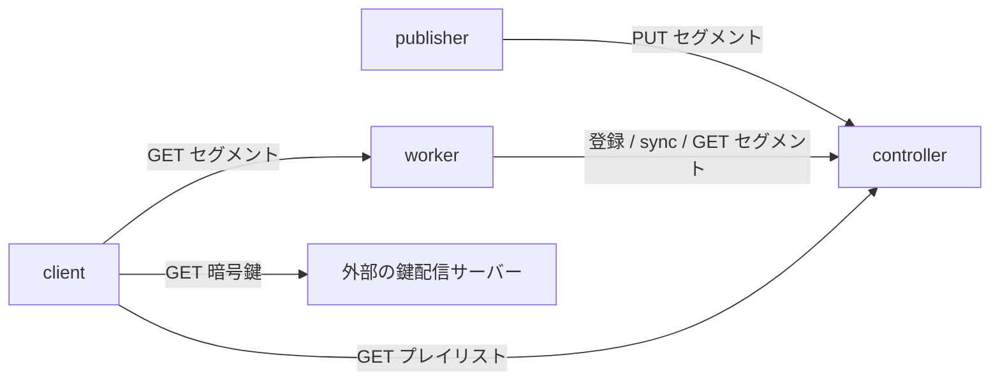

# ドキュメント案内

Edamame は、ライブ HLS 配信のセグメントをメモリに保持する配信システムである。
最小構成の起動は [導入手順](../README.md)、設定と動作の詳細は各コンポーネントの文書を参照する。

## 目的別の入口

| 文書 | 内容 |
| --- | --- |
| [controller](./controller.md) | 起動と設定、保存と採番、公開範囲、worker 選択、外部配信 |
| [worker](./worker.md) | 起動と設定、登録と同期、キャッシュ、再取得、TLS / ACME |
| [publisher](./publisher.md) | ライブ入力、エンコード、暗号化、鍵登録、検証用 publisher |
| [運用](./operations.md) | パラメータの調整、メモリ見積もり、通信の保護、再生確認、障害切り分け |
| [controller の冗長化](./cluster.md) | 複数台の起動、DNS、leader 選出、転送、交代と通信分断時の制約 |
| [HTTP API](./api.md) | エンドポイント、認証、リクエストとレスポンス、再 PUT、ステータス |
| [HLS の出力](./hls.md) | 対応形式、プレイリストのタグと出力例、暗号化タグ、再生上の制約 |
| [可観測性](./observability.md) | 共通のメトリクス仕様、送信設定、ヘルスチェック、ローカルでの確認方法 |

各コンポーネントの CLI / 設定表は、そのコンポーネントの文書にまとめる。
HTTP の形式は HTTP API、HLS タグの形式は HLS の出力にまとめ、他の文書では参照する。

## 全体構成

publisher は映像を MPEG-TS セグメントへ分割し、controller に PUT する。
controller は番号を割り当てて原本を保存し、worker が pull 方式で複製を取得する。
client は controller のプレイリストに書かれた worker の URL から映像を取得する。

controller は台数によらず leader を選び、保存とプレイリスト生成を leader で処理する。
follower は配信用のリクエストを転送し、セグメントや採番状態は複製しない。
worker はキャッシュと配信だけを担当し、プレイリストを生成しない。
publisher は controller へプレイリストを送信せず、鍵の実体も controller / worker には保存しない。

## 共通のデータと役割

| データ | 役割と保持期間 |
| --- | --- |
| channel | `channel_id` で識別する 1 本の配信。最初のセグメントの PUT で作られる |
| quality | channel 内の画質。`quality` で識別し、ビットレートと任意の解像度を持つ |
| セグメント識別子 | publisher が付ける `identifier`。同じ時間帯の全 quality で同じ値を使う |
| セグメント番号 | controller が識別子へ channel ごとに割り当てる `sequence`。`0` から始まる |
| 原本データ | controller がメモリに保存する元のセグメントと属性。再起動または leader 交代で失われる |
| キャッシュ | worker がメモリに持つセグメント本体。原本が残る間は再取得できる |
| 暗号化指定 | セグメントごとの `key_uri` と任意の IV。controller がプレイリストへ出力する |
| 暗号鍵 | publisher または外部サービスが配布し、client が直接取得する |
| 公開範囲 | 1 台以上の稼働 worker が途切れずに保持する、プレイリストに載せる番号の範囲 |
| 外部配信 | 同じ番組を配信する別の HLS。controller が master のリクエストをリダイレクトする |

セグメントは `(channel_id, quality, sequence)` で区別する。
識別子の文字種、長さ、属性の制約は [HTTP API の共通ルール](./api.md#共通ルール) と [属性の一貫性](./api.md#セグメント属性の一貫性と再登録の扱い) を参照する。

保存容量とキャッシュ上限は別の単位である。
controller の保存容量は全セグメント本体の合計バイト数、worker のキャッシュ上限は `(channel_id, quality)` ごとのファイル数に適用する。
これらはプロセス全体のメモリ使用量を制限するものではない。

## 対応範囲と保証しないこと

対象は、セグメントが継続的に追加されるライブ HLS 配信である。
次の機能や保証は提供しない。

- VOD、fMP4、LL-HLS、バイト範囲、複数音声、I フレーム用プレイリスト
- AES-128-CBC 以外の暗号化と、controller / worker での鍵の保管や配布
- セグメント、採番状態、worker キャッシュの永続化
- controller 間の状態複製と、leader 交代をまたぐ PUT の保持
- worker の実負荷に合わせた配置や重みの自動調整
- 全 quality の公開範囲の一致と、範囲切り替え時の連続再生
- controller 自体の TLS 終端
- アプリ自体の Prometheus 用 `/metrics`（OTLP/gRPC で送信する）

再起動や交代で番号がリセットされ、worker の停止によって公開範囲が戻ったり飛んだりする場合がある。
可用性だけでなく、使用するプレイヤーがこれらの変更から復旧できるかを配信前に確認する。
