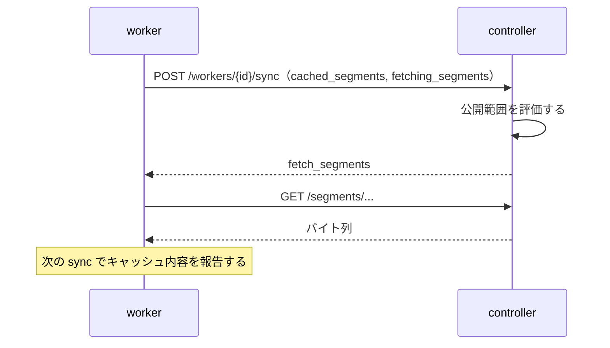

# HTTP API

この文書では、`controller` と `worker` が提供する HTTP API の仕様を説明する。
全体構成と各文書の役割は [ドキュメント案内](./README.md) を参照する。

## エンドポイント一覧

| 提供元 | メソッドとパス | 呼び出し元 | 認証 | 用途 |
| --- | --- | --- | --- | --- |
| controller | `GET /internal/cluster/health` | peer / 運用者 | なし | インスタンス自身の役割、metric、leader URL の取得 |
| controller | `POST /internal/cluster/heartbeat` | peer | Bearer（必須） | 生存確認と既知 member の交換 |
| controller | `PUT /segments/{channel_id}/{quality}/{identifier}` | publisher | Bearer（必須） | 正規セグメントファイルの登録と連番（`sequence`）の採番 |
| controller | `PUT /channels/{channel_id}/external` | publisher | Bearer（必須） | 外部配信のマスタープレイリスト URL の登録と解除 |
| controller | `PUT /workers/{worker_id}` | worker | Bearer（必須） | `worker` の公開 URL と重みの登録、および `sync` 間隔の取得 |
| controller | `POST /workers/{worker_id}/sync` | worker | なし | キャッシュ状況の報告と不足セグメント（`fetch_segments`）の取得指示 |
| controller | `GET /segments/{channel_id}/{quality}/{filename}` | worker | なし | 正規セグメントファイルの取得（キャッシュ用） |
| controller | `GET /channels/{channel_id}/master.m3u8` | client / publisher | なし | マスタープレイリストの取得（または外部配信への `302` リダイレクト） |
| controller | `GET /channels/{channel_id}/{quality}.m3u8` | client / publisher | なし | 画質（`quality`）別のメディアプレイリストの取得 |
| worker | `GET /segments/{channel_id}/{quality}/{filename}` | client | なし | キャッシュ済みセグメントファイルの配信 |

以下の例では、`controller` の URL を `http://127.0.0.1:9000`、`worker` の `public_url` を `http://127.0.0.1:9001` とする。
`controller` の `--bind` は待ち受けアドレスであり、`client` や `worker` が接続する URL ではない。
`0.0.0.0` などで待ち受ける場合、`client` は `controller` に到達できる URL を基底 URL として使い、`worker` も同様に到達できる URL を `--controller-url` に指定する。

## 共通ルール

### 識別子とファイル名の形式

- `channel_id`、`quality`、`worker_id`、およびセグメント識別子（`identifier`）は `[A-Za-z0-9_-]` の 1 文字以上 64 文字以下とし、それ以外は `400 Bad Request` で拒否する
- `quality` に `master` は使えず、指定した場合は `400 Bad Request` で拒否する
- `sequence` はセグメント番号を表し、先頭に不要な `0` を付けない 10 進数の `u64` とする。セグメント取得時のファイル名は `{sequence}.ts` だけを許可する

### リクエストとレスポンスの形式

- JSON を送るリクエストの Content-Type は `application/json` とする。Content-Type の不一致、JSON の構文エラー、型の不一致、必須項目の欠落はすべて `400 Bad Request` を返す
- リクエストボディのサイズ上限は、`PUT /segments/...` と `POST /workers/{worker_id}/sync` が 64 MiB、`PUT /workers/{worker_id}` と `POST /internal/cluster/heartbeat` が 4 MiB、`PUT /channels/{channel_id}/external` が 64 KiB とする。JSON エンドポイントで上限を超えた場合は `400 Bad Request`、`PUT /segments/...` で上限を超えた場合は `413 Payload Too Large` を返す
- JSON を返すレスポンスの Content-Type は `application/json` とする
- プレイリストの Content-Type は `application/vnd.apple.mpegurl`、セグメントファイルの Content-Type は `application/octet-stream` とする
- エラー応答の本文は英語の plain text とし、Content-Type は `text/plain; charset=utf-8` とする

### 認証と CORS

- `controller` はすべての `PUT` エンドポイントに `Authorization: Bearer {token}` を要求する。ヘッダがない場合やトークンが一致しない場合は、`WWW-Authenticate: Bearer` ヘッダを付けて `401 Unauthorized` を返す。`GET` と sync の `POST` は認証を要求せず、heartbeat の `POST` は常に Bearer 認証を要求する
- ブラウザからは `GET` だけ cross-origin で読み取れる。許可する origin は `controller` と `worker` の `--cors-origin`（`*`、`none`、またはカンマ区切りの origin 一覧。`*` や `none` は他の値と混在不可）で指定し、省略または `none` を指定すると CORS ヘッダを返さない

### ステータスコードの判定順

- leader での基本的な判定順は、認証チェック（`401`）、入力検証（`400`）、対象の存在確認（`404`）、および各エンドポイント固有の状態や容量の判定（`302`、`409`、`413`、`422`、`503`）とする
- 予期しない内部エラーは `500 Internal Server Error` を返す

## 死活監視

controller と worker は、死活監視用の `GET /health` を提供する。

| プロセス | パス | 応答 |
| --- | --- | --- |
| controller | `/health` | `200 ok` |
| worker | `/health` | `200 ok` |
| worker（`path_prefix` あり） | `{path_prefix}/health` | `200 ok` |

認証は不要で、プロセスが HTTP リクエストを受け付けられることだけを返す。依存先の状態は確認しない。

## controller の API

### インスタンスの役割を取得する

```http
GET /internal/cluster/health
```

認証なしで常に 200 と、そのインスタンス自身の状態を返す。
leader に転送しない。

```json
{
  "role": "follower",
  "public_url": "http://controller-b.test:9000",
  "metric": 10,
  "leader_url": "http://controller-a.test:9000"
}
```

`role` は `leader` または `follower` とする。
cluster の起動直後は `follower` と `leader_url: null` を返す。
`public_url` は必ず自分自身の公開 URL を文字列で返す。
metric を省略した場合は `100` になる。
200 はインスタンス自身が応答できることを示し、leader の確定や配信可能なプレイリストの存在を保証しない。

### peer と heartbeat を交換する

```http
POST /internal/cluster/heartbeat
Authorization: Bearer {token}
Content-Type: application/json
```

全 peer に共通の `--auth-token` が必須になる。
自分の public URL、metric、既知の member 一覧を送る。
リクエストの `role` と `leader_url` は省略でき、省略した role は `follower` として扱う。
送信例を示す。

```json
{
  "public_url": "http://controller-b.test:9000",
  "metric": 10,
  "role": "follower",
  "leader_url": "http://controller-a.test:9000",
  "members": [
    {
      "public_url": "http://controller-a.test:9000",
      "metric": 20,
      "role": "leader"
    }
  ]
}
```

受信側は 200 と自分の `public_url`、`metric`、`role`、`leader_url`、`members` を同じ形式で返す。
member の role を省略した場合も `follower` として扱う。
member 一覧には受信側が既知の peer を返し、自分自身は一覧に含めない。
URL は HTTP または HTTPS の絶対 URL とし、query と fragment は許可しない。
JSON body の上限は 4 MiB とする。
生存確認と leader 判定の規則は [controller の冗長化](./cluster.md) に従う。

| status | 条件 |
| --- | --- |
| 200 | heartbeat を受け付けた |
| 401 | Authorization がない、または token が一致しない |
| 400 | JSON または URL が不正、または body が上限を超えている |

### follower の転送と leader 未確定時の応答

`/health`、`/internal/cluster/health`、heartbeat を除き、follower の GET と sync の POST は `307 Temporary Redirect` を返す。
Location は leader の public URL に元の API の path と query を連結する。
HTTP と HTTPS の両方を許可する。
public URL に接頭辞がある場合、API はその下に公開され、転送では leader の接頭辞に置き換わる。

```http
HTTP/1.1 307 Temporary Redirect
Location: https://controller-a.test/base/segments/live/720p/0.ts?x=1
Cache-Control: no-store
```

GET の応答には `--cors-origin` の設定に応じた読み取り用 CORS ヘッダーを付ける。
sync の redirect に CORS ヘッダーは付けない。
client は 307 に追従し、sync では POST と JSON body を保持する。

認証付き PUT は follower 自身で認証した後、leader へ内部中継する。
Authorization、Content-Type、body を保持し、leader の status、応答ヘッダー、body を返す。
入力の検証と採番は leader が行い、follower は保存しない。

leader URL が未確定の間は、各業務 API に次の応答を返す。
PUT の認証はこの判定より先に行う。
PUT の中継失敗でも同じ 503 を返し、heartbeat の再確認を要求する。

```http
HTTP/1.1 503 Service Unavailable
Retry-After: 1
Cache-Control: no-store
```

leader の交代で状態は失われる。
worker は sync の 404 で再登録し、client はプレイリストの 404 または 503 の後に取り直す。

### セグメントファイルを登録する（publisher 用）

```
PUT /segments/{channel_id}/{quality}/{identifier}?duration_ms={duration_ms}&bandwidth={bandwidth}&resolution={width}x{height}&key_uri={key_uri}&iv={iv}
```

`publisher` が正規セグメントファイルを登録する。
`channel_id` と `quality` を事前に作成する専用の API はなく、最初のセグメントファイルを `PUT` した時点で自動的に作られる。
`Authorization: Bearer {token}` ヘッダに、`controller` と同じ token を必ず付ける。

`identifier` はセグメントごとに `publisher` が付ける識別子である。
画質が複数あっても、同じ時間帯のセグメントには同じ識別子を使う。
クエリパラメータのうち、`duration_ms` と `bandwidth` は必須であり、`resolution`、`key_uri`、`iv` は省略できる。
`duration_ms` にはセグメント長をミリ秒で表す 500 以上の整数、`bandwidth` にはビットレートを bit/s で表す正の整数、`resolution` には解像度を表す `{width}x{height}` の形式を指定する。

セグメントを暗号化する場合は、暗号鍵の取得先 URL を `key_uri` に指定し、必要に応じて初期化ベクトルを `iv` に指定する。
`iv` は 16 バイトを表す 32 文字の 16 進数で指定し、大文字と小文字のどちらでもよい。
`controller` は `iv` を小文字にそろえて保存する。
`iv` は `key_uri` と組で使うため、`key_uri` を指定せずに `iv` だけを付けると `400 Bad Request` になる。
`key_uri` と `iv` は他の属性と異なり、同じ識別子の再 `PUT` で値を変えても競合（`409 Conflict`）にはならない。
最後に受け取った組でそのセグメントの暗号化指定を置き換え、省略した場合は暗号化なしに戻す。

例：

```bash
curl -i -X PUT \
  -H 'Authorization: Bearer example-token' \
  --data-binary @segment-1.ts \
  'http://127.0.0.1:9000/segments/live/720p/segment-1?duration_ms=6000&bandwidth=3000000&resolution=1280x720'
```

暗号化するセグメントは暗号鍵の URI と IV を付けて `PUT` する。

```bash
curl -i -X PUT \
  -H 'Authorization: Bearer example-token' \
  --data-binary @segment-1.ts \
  'http://127.0.0.1:9000/segments/live/720p/segment-1?duration_ms=6000&bandwidth=3000000&resolution=1280x720&key_uri=https%3A%2F%2Fkeys.example.test%2Flive%2Fkey-1&iv=9f2c4a1d6b8e0f3a5c7d1e2b4a6c8d0e'
```

レスポンス：

```json
{
  "sequence": 0
}
```

`controller` は新しい識別子に `channel` ごとの連番を割り当てる。
連番は起動するたびに `0` から始める。
同じ `channel` では、同じ識別子には `quality` が違っても同じ番号を割り当て、同じ識別子の再 `PUT` には割り当て済みの番号を返す。

ステータス：

- `201 Created`：新しいセグメントファイルを保存した
- `200 OK`：同じ識別子、同じ `quality`、同じバイト列のセグメントファイルがすでにある
- `401 Unauthorized`：`Authorization` ヘッダがない、またはトークンが一致しない
- `400 Bad Request`：識別子、`duration_ms`、`bandwidth`、`resolution`、`key_uri`、`iv` の形式が不正、`iv` を `key_uri` なしで指定した、または `duration_ms` が 500 未満
- `409 Conflict`：保存されている同じ識別子で違うバイト列のセグメントファイルがある、同じ `quality` に異なる `bandwidth` や `resolution` がある、または同じ `channel` の他のセグメントファイルと違う `duration_ms` を指定した
- `413 Payload Too Large`：セグメントファイルが `--storage-capacity` またはリクエスト上限（64 MiB）より大きい
- `500 Internal Server Error`：セグメント番号の上限に達した

#### セグメント属性の一貫性と再登録の扱い

- `duration_ms`（`channel` 単位で固定）：同じ `channel` の全セグメントで同じ値でなければならない。最初に成功した `PUT` の `duration_ms` を秒に直して小数点以下を切り上げた整数（下限は 1）が、その `channel` の `#EXT-X-TARGETDURATION` の基準値になる。2 つ目以降の `PUT`（再 `PUT` を含む）で異なる `duration_ms` を指定した場合は `409 Conflict` を返す
- `bandwidth`（`quality` 単位で固定）：`quality` の最初の `PUT` で決まり、2 つ目以降の `PUT` で異なる値を指定した場合は `409 Conflict` を返す
- `resolution`（`quality` 単位で固定、省略可）：未設定の `quality` には後から指定でき、一度決まった後に省略した `PUT` は既存の値を維持する。すでに決まっている値と異なる値を指定した場合は `409 Conflict` を返す

`controller` を再起動すると、保存済みのセグメントファイルおよび識別子とセグメント番号の対応は失われ、セグメント番号は `0` から始まる。
再起動後に以前と同じ識別子を `PUT` すると、新しい番号を割り当てて保存する。
容量超過で削除された識別子についても、別の `quality` に同じ識別子が残っていなければ、再 `PUT` には新しい番号を割り当てる。

### channel の外部配信を登録する（publisher 用）

```
PUT /channels/{channel_id}/external
```

`publisher` が、別 CDN などで同じ番組を配信している外部配信のマスタープレイリスト URL を登録する。
登録すると、`GET /channels/{channel_id}/master.m3u8` へのアクセスの一部または全部を `302 Found` でその URL へリダイレクトできるようになる。
`external_m3u8` は host を持つ `http` または `https` の絶対 URL とし、fragment は含めず、query は含めてもよい。
`null`（またはフィールドを省略した `{}`）を送ると登録を取り消す。
`controller` は登録された URL を取得せず、`client` が外部配信から直接取得する。
`channel` は最初のセグメントファイルを `PUT` したときに作られるため、`channel` がまだない場合は `404 Not Found` を返す。

リクエスト：

```json
{ "external_m3u8": "https://px.example.test/abc/def.m3u8" }
```

```json
{ "external_m3u8": null }
```

例：

```bash
curl -i -X PUT \
  -H 'Authorization: Bearer example-token' \
  -H 'Content-Type: application/json' \
  -d '{"external_m3u8":"https://px.example.test/abc/def.m3u8"}' \
  'http://127.0.0.1:9000/channels/live/external'
```

ステータス：

- `204 No Content`：登録または解除した
- `400 Bad Request`：`channel_id` または `external_m3u8` の形式が不正である
- `401 Unauthorized`：Authorization がない、または token が一致しない
- `404 Not Found`：`channel` が存在しない

### worker を登録する（worker 用）

```
PUT /workers/{worker_id}
```

リクエスト：

```json
{
  "public_url": "http://127.0.0.1:9001",
  "weight": 1
}
```

`public_url` には、`client` がアクセスする `http` または `https` の絶対 URL を指定する。
query と fragment は含めず、末尾に `/` がある場合は取り除いて保存する。
URL にパスを含めた場合は、そのパスの後ろに `/segments/...` を続けた URL をメディアプレイリストに出力する。
`weight` には、`worker` の重みを表す 1 以上の整数を指定する。
`controller` は配信先の `worker` を選ぶときにこの値を使い、重みが大きい `worker` ほど高い割合で選ぶ。

`worker` は起動時にこのエンドポイントを呼んで自身を登録する。
`worker` 側にも `controller` と同じ `--auth-token` を指定して `Authorization: Bearer {token}` を送る。
`controller` の再起動などで登録が失われた場合、`worker` は `sync` の `404 Not Found` を受け取った時点で再登録を行う。
`worker` は登録のたびに手元のキャッシュを捨てて取り直すため、`controller` も登録に合わせて報告済みのキャッシュを無効にする。

レスポンス：

```json
{
  "sync_interval_ms": 1000
}
```

`worker` は次に登録するまで、返された `sync_interval_ms`（正の整数）の間隔で `sync` を送る。
ステータスが `201` と `200` のどちらでも、レスポンスは同じ形式になる。

ステータス：

- `201 Created`：新しい `worker` を登録し、タイムアウトの基準時刻を現在時刻にする
- `200 OK`：登録済みの `worker` の `public_url` と `weight` を更新し、報告済みのキャッシュを無効にする。タイムアウトの基準時刻は更新しないため、直後に `sync` を送らなければ `--sync-timeout-ms` の経過で配信候補から外れる
- `401 Unauthorized`：`Authorization` ヘッダがない、またはトークンが一致しない
- `400 Bad Request`：`worker_id`、`public_url`、または `weight` が不正である

### worker を同期する（worker 用）

```
POST /workers/{worker_id}/sync
```

`sync` は `worker` が開始する pull 方式の同期処理である。
`controller` から `worker` へセグメントファイルのバイト列を直接 `PUT` することはない。



リクエスト：

```json
{
  "cached_segments": [
    { "channel_id": "live", "quality": "720p", "sequence": 101 }
  ],
  "fetching_segments": [
    { "channel_id": "live", "quality": "720p", "sequence": 102 }
  ]
}
```

レスポンス：

```json
{
  "fetch_segments": [
    { "channel_id": "live", "quality": "720p", "sequence": 102 }
  ]
}
```

各フィールドの役割は次のとおり。

- `cached_segments`（リクエスト）：`worker` がその時点でメモリ上にキャッシュしている全セグメントの一覧
- `fetching_segments`（リクエスト）：`worker` がその時点で `controller` からダウンロード中のセグメントの一覧
- `fetch_segments`（レスポンス）：`worker` がこれから取得すべきセグメントの一覧。各項目は `channel_id`、`quality`、`sequence` を持ち、`worker` は `{controller_url}/segments/{channel_id}/{quality}/{sequence}.ts` を `GET` する

`fetch_segments` には、すべての `channel` と `quality` のキャッシュ対象（各 `quality` の最新セグメント番号から `--playlist-segments` 個分の範囲）のうち、`cached_segments` に含まれていない未キャッシュのセグメントが入る。
また、ある `quality` のセグメントが容量超過で削除されたものの別の `quality` に同じ識別子が残っている状態で、削除された `quality` に同じ識別子が再 `PUT` されると、以前と同じセグメント番号に保存し直される。
このとき、`cached_segments` または `fetching_segments` にその番号を含む `worker` に対して再取得を指示するため、該当セグメントも `fetch_segments` に入る。
`worker` は再取得したバイト列でキャッシュを上書きする。

`controller` は `sync` を受け取るたびに、各 `quality` の公開範囲を再評価する。
公開待ちと連続範囲の選び方は [controller の公開範囲の決定](./controller.md#公開範囲の決定) を参照する。

ステータス：

- `200 OK`：`sync` を受け付けた
- `400 Bad Request`：`worker_id`、`cached_segments`、または `fetching_segments` の識別子が不正である
- `404 Not Found`：`worker` が登録されていないため、`worker` は再登録を行う

### セグメントファイルを取得する（worker 用）

```
GET /segments/{channel_id}/{quality}/{filename}
```

`worker` が `sync` の `fetch_segments` に従って正規セグメントファイルを取得するときに使う。
`controller` はメモリに保存しているセグメントファイルを返す。
容量を超えて削除されたセグメントファイルと、`controller` の再起動で失われたセグメントファイルは `404 Not Found` になる。

ステータス：

- `200 OK`：セグメントファイルのバイト列を返す
- `400 Bad Request`：識別子またはファイル名が不正である
- `404 Not Found`：セグメントファイルが存在しない

### マスタープレイリストを取得する（client 用）

```
GET /channels/{channel_id}/master.m3u8
```

出力形式の詳細は [HLS の出力](./hls.md) で説明する。
`200 OK` と `302 Found` のレスポンスには `Cache-Control: no-store` ヘッダが付く。

ステータス：

- `200 OK`：マスタープレイリストを返す
- `302 Found`：外部配信へ振り分ける。`Location` に登録された外部配信のマスタープレイリスト URL を返す
- `400 Bad Request`：`channel_id` が不正である、または query の `external` に `1` と `0` 以外の値を指定した
- `404 Not Found`：`channel` が存在しない
- `422 Unprocessable Entity`：公開範囲のセグメントファイルが欠落している
- `503 Service Unavailable`：配信できる `quality` がない

クエリパラメータに `external=1` を付けると外部配信へ振り分け、`external=0` を付けると自前のマスタープレイリストを返す。
`external=0` は、外部配信を登録している環境でもリダイレクトさせずに `controller` 自身のプレイリストを取得したい場合（`publisher` が再起動時に現在のセグメント番号を確認する場合や、運用者が直接動作確認する場合）に使う。
外部配信が登録されていなければ `302` は返さず、`external=1` でも自前のマスタープレイリストを返す。

クエリパラメータを省略した場合は、接続元の IP と `channel` から決まる値と、その時点の公開の遅れに応じた外部配信の割合とを比較し、リクエストごとに振り分けを判定する。

### メディアプレイリストを取得する（client 用）

```
GET /channels/{channel_id}/{quality}.m3u8
```

出力形式の詳細は [HLS の出力](./hls.md) で説明する。

ステータス：

- `200 OK`：メディアプレイリストを返す
- `400 Bad Request`：`channel_id` または `quality` が不正である
- `404 Not Found`：`channel` または `quality` が存在しない
- `422 Unprocessable Entity`：公開範囲のセグメントファイルが欠落している
- `503 Service Unavailable`：その `quality` の公開範囲または配信先 `worker` がない

## worker の API

### セグメントファイルを配信する（client 用）

```
GET /segments/{channel_id}/{quality}/{filename}
```

`worker` がメモリ上にキャッシュしているセグメントファイルを `client` に返す。
`worker` はキャッシュしていないセグメントファイルをその場で `controller` から取得することはせず、`404 Not Found` を返す（セグメントの取得はすべて `sync` の `fetch_segments` に従って非同期に行う）。

ステータス：

- `200 OK`：セグメントファイルのバイト列を返す
- `400 Bad Request`：識別子またはファイル名が不正である
- `404 Not Found`：`worker` がそのセグメントファイルをキャッシュしていない
